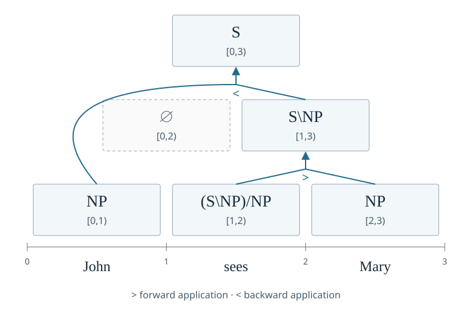
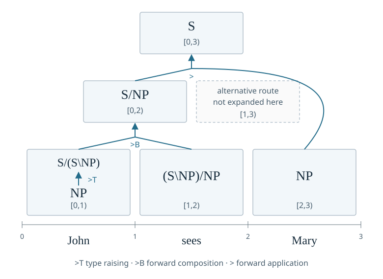

# Charts and approximation

## Reusing partial analyses

A sentence can have many analyses that share smaller pieces. A [chart](../reference/deduce.md#lofi.deduce.Chart)
stores results for contiguous stretches of words, called [**spans**](#spans-and-the-sweep), so that
larger analyses can reuse them. This is dynamic programming: solve smaller
subproblems, retain their results, and combine those results into larger ones.
A chart item records a [category](logical-forms-as-types.md#start-with-a-sentence) and its span, together with any required
state, and can summarize several trees. A [packed forest](../reference/deduce.md#lofi.deduce.PackedForest) additionally
records those alternative derivations while sharing their common parts.

The chart below parses *John sees Mary* using only forward and backward
[application](logical-forms-as-types.md#rules-and-computational-directions).
Each box holds the categories derived for one span:

Read upward from the words. The verb first takes its object on the right,
producing $\mathrm{S}\backslash\mathrm{NP}$ for *sees Mary*. That result
takes its subject on the left, producing $\mathrm{S}$ for the whole sentence.
The empty $[0,2)$ cell means that these lexical assignments and application
rules cannot combine *John sees*. The chart records that failed span as
well as the successful ones; a [derivation tree](derivations-as-proofs.md#from-words-to-a-derivation) shows only the successful
combinations used in one analysis.

The right endpoint marks the boundary immediately after the last included word. Filling short spans first ensures that a larger span's parts
are available when needed. A grammar may reject some combinations, and a
cell may retain several alternatives instead of selecting one immediately.

### Adding type raising and composition

The empty *John sees* cell depends on the [rule inventory](../how-to/grammars/choose-combinatory-rules.md#expand-a-concise-inventory). If the grammar also
permits forward [type raising](../how-to/grammars/choose-combinatory-rules.md#the-rule-families) of $\mathrm{NP}$ to target $\mathrm{S}$ and [forward composition](../how-to/grammars/choose-combinatory-rules.md#the-rule-families),
it can build a sentence missing its object before that object arrives:

This figure traces one additional derivation within the expanded grammar;
its cells show the items used on that route. Type raising ($>T$) adds an item
within the same lexical cell: *John* can be viewed as an expression waiting
for a predicate that takes John as its subject. Forward composition ($>B$)
combines that expression with the transitive verb, leaving its object
argument unfilled. Forward application ($>$) supplies *Mary*:

$$
\frac{
  \displaystyle\frac{
    \displaystyle\frac{\mathrm{NP}}{\mathrm{S}/(\mathrm{S}\backslash\mathrm{NP})}\;>T
    \qquad (\mathrm{S}\backslash\mathrm{NP})/\mathrm{NP}
  }{\mathrm{S}/\mathrm{NP}}\;>B
  \qquad\mathrm{NP}
}{\mathrm{S}}\;>.
$$

To read the [meanings](logical-forms-as-types.md#category-to-type-interpretation), let $j$ denote John, $m$ Mary, and let the verb mean
$v=\lambda o.\lambda s.\operatorname{see}(s,o)$, taking its object before
its subject. Raising John gives $\lambda p.p(j)$. Composing that function
with $v$ gives

$$
\begin{aligned}
\lambda o.(\lambda p.p(j))(v(o))
&\longrightarrow_\beta\lambda o.(v(o))(j)\\
&\longrightarrow_\beta\lambda o.(\lambda s.\operatorname{see}(s,o))(j)\\
&\longrightarrow_\beta\lambda o.\operatorname{see}(j,o).
\end{aligned}
$$

Applying it to $m$ yields $\operatorname{see}(j,m)$, the same result as
first applying the verb to Mary and then supplying John. The two derivations
thus express the same meaning in this interpretation. Their redundancy is an instance of
[spurious ambiguity](derivations-as-proofs.md#normal-forms); a declared normal
form may retain only one route. See [rule selection](../how-to/grammars/choose-combinatory-rules.md)
for declaring the rules and [the rule API](../reference/judge.md#lofi.judge.Rule) for their
implementation.

## Spans and the sweep

For a string $w_1\cdots w_n$, a chart is indexed by half-open spans
$[i,j)$, where $0\leq i<j\leq n$. The span covers
$w_{i+1}\cdots w_j$, has width $j-i$, and admits binary split points
$i<k<j$.
[`SpanIndex`](../reference/deduce.md#lofi.deduce.SpanIndex) assigns each span a dense identifier,
grouped by width and then by start, so that the $n(n+1)/2$ nonempty spans of a sentence
can be stored in flat tensors. Its [`decompositions(region, arity)`](../reference/deduce.md#lofi.deduce.SpanIndex.decompositions) enumerates
every way of cutting a span into `arity` contiguous nonempty parts, left to
right, so the sweep obtains the premises for any rule arity the grammar uses,
not only binary splits.

The packaged strategy is [`cky`](../reference/deduce.md#lofi.deduce.CkyStrategy), a bottom-up traversal of the kind used in
Cocke–Kasami–Younger parsing \citep{younger1967,goodman1999}. It proceeds from narrow
spans to wide ones, in which every span is visited after all the spans it
decomposes into. Within one width, cells are independent, and the native kernel
may fill up to the budget's [`threads`](../reference/formalism.md#lofi.formalism.Budget.threads) of them concurrently. Every parse inside a
run takes this count: the counterfactual and synthetic corpus parses, the A\*
decoding parse of held-out evaluation, and the derivation count census. A grammar with a
unary rule runs unary closure rounds in each cell, bounded by the budget's
[`unary_rounds`](../reference/formalism.md#lofi.formalism.Budget.unary_rounds). Spans are contiguous with fan-out one; the [`RegionIndex`](../reference/formalism.md#lofi.formalism.RegionIndex)
protocol in [`lofi.formalism`](../reference/formalism.md) admits other fan-outs,
and a consumer that serves only fan-out one refuses a grammar that needs more
(see [Grammars as deductive systems](derivations-as-proofs.md)).

## What a semiring decides

One chart sweep computes different quantities under different [semirings](../reference/deduce.md#lofi.deduce.Semiring)
\citep{goodman1999}. The weight of an item is the [semiring sum](../reference/deduce.md#lofi.deduce.Semiring.plus), over its
derivations, of the [semiring product](../reference/deduce.md#lofi.deduce.Semiring.times) of the weights of their steps.

Let $(K,\oplus,\otimes,0_K,1_K)$ be a semiring. In a finite acyclic
packed forest, an edge $e$ has parent $v$, an ordered list of children
$\operatorname{ch}(e)$, and weight $w_e\in K$. With lexical alternatives
represented as nullary edges, the inside recurrence is:

$$
\alpha_v=
\bigoplus_{e:\operatorname{pa}(e)=v}
\left(w_e\otimes\bigotimes_{u\in\operatorname{ch}(e)}\alpha_u\right).
$$

The empty product is $1_K$ and the empty sum is $0_K$. Child order matters
when multiplication is noncommutative. Extending the recurrence to infinitely
many cyclic derivations requires a well-defined infinite sum under additional
semiring assumptions. Finite unary unrolling
restricts the computation to derivations within the unrolling bound
\citep{goodman1999}.

| Semiring | Computes |
| --- | --- |
| [`counting`](../reference/deduce.md#lofi.deduce.Counting) | The number of derivations, exactly, promoting to arbitrary precision on overflow. |
| [`boolean`](../reference/deduce.md#lofi.deduce.Boolean) | Whether an item is derivable at all. |
| [`viterbi`](../reference/deduce.md#lofi.deduce.Viterbi) | The largest derivation log weight, using $(\max,+)$. |
| [`log-inside`](../reference/deduce.md#lofi.deduce.LogInside) | The log of the sum of derivation weights, using $(\operatorname{logsumexp},+)$. |
| [`k-best`](../reference/deduce.md#lofi.deduce.KBest) | The $k$ highest derivation log weights. |
| [`expectation`](../reference/deduce.md#lofi.deduce.Expectation) | A total weight paired with an unnormalized weighted statistic; normalize to obtain an expectation. |
| [`forest`](../reference/deduce.md#lofi.deduce.Forest) | Every derivation, as edge sequences. |

The [run document](documents-are-the-dsl.md#the-document-is-the-program)'s [`parse.semiring` family](../reference/spec.md#lofi.spec.SymbolicSemiringSpec) registers every semiring above, so
any of them may be the run's parse; each is also available from
[`lofi.deduce`](../reference/deduce.md#lofi.deduce) for direct use, as [the semiring
tutorial](../tutorials/07-charts-and-semirings.md) shows. A declared semiring
states [what its weights can serve](../reference/spec.md#lofi.spec.SemiringCapability) beyond the semiring laws. `log-inside` and
`viterbi` weights are floating-point log weights, which a beam can rank and A\* can
bound; only `log-inside` weights sum over derivations, so only they yield
[posterior marginals and summed goal weight](#inside-outside-and-marginals) through these interfaces. `counting`, `boolean`, `k-best`,
`expectation` and `forest` weights are neither. A component that needs a
capability the declared semiring lacks, such as the [`top-k` pruner](../reference/deduce.md#lofi.deduce.TopKPruner), A\*
decoding, a [minimum Bayes risk decode](../how-to/evaluation/decode-derivations.md#choose-the-decision-rule) or the [Bisk--Hockenmaier baseline](../reference/eval.md#lofi.eval.BiskHockenmaierInducer), is
refused when the run is composed, with an error naming the capability. The
[neural losses](induction-objectives.md#objectives-read-published-outputs) read neural outputs independently of the symbolic parse's semiring.

The exported [conformance properties](../reference/laws.md#lofi.deduce.laws.check_semiring_laws) check that plus is a commutative monoid
with zero as its identity, that times is a monoid, that times distributes over
plus on both sides, and that zero annihilates; every semiring above is tested
against them, the floating-point ones up to a tolerance. Commutativity of times
and idempotence of plus are not checked. Consumers that need more than these
laws say so: outside marginals and pruned goal mass require a semiring that
declares [`log_probability`](../reference/deduce.md#lofi.deduce.Semiring.log_probability), the API capability for log weights summed by
log-sum-exp (among the built-in semirings, only `log-inside`), and
refuse any other; a [normal form](derivations-as-proofs.md#normal-forms) other than `none` makes a category's
weight a sum over its normal form derivations only, so `counting` counts
those.

A derivation's log weight becomes a log probability after normalization. Write
$s(d)=\sum_{e\in d}s_e$ for a derivation's additive score, including its
root weight, and let $\mathcal D(w)$ contain the derivations admitted by the
forest and goal. For $0<z(w)<\infty$,

$$
z(w)=\sum_{d\in\mathcal D(w)}\exp s(d),
\qquad
p(d\mid w)=\frac{\exp s(d)}{z(w)}.
$$

This defines a [conditional PMF](reading-the-notation.md#sums-products-and-probabilities) over derivations. The scalar $z(w)$ is a
partition function; it is a string probability only under an additional
normalized generative model. Viterbi computes $\max_d s(d)$, whereas
the log inside algorithm computes $\log z(w)$. Their values answer different questions.
When $z(w)=0$, no accepted positive-weight derivation exists and the
conditional PMF is undefined; the [outside API](../reference/deduce.md#lofi.deduce.Outside) reports zero marginals.

For the first-order [expectation semiring](../reference/deduce.md#lofi.deduce.Expectation), a pair $(z,\boldsymbol{r})$
accumulates a total weight and a weighted additive statistic. Its operations are
\citep{li-eisner2009}:

$$
\begin{aligned}
(z,\boldsymbol{r})\oplus(z',\boldsymbol{r}')
  &=(z+z',\boldsymbol{r}+\boldsymbol{r}'),\\
(z,\boldsymbol{r})\otimes(z',\boldsymbol{r}')
  &=(zz',z\boldsymbol{r}'+z'\boldsymbol{r}).
\end{aligned}
$$

Initialize each edge with $(a_e,a_e\boldsymbol{f}_e)$, where
$a_e=\exp(s_e)$ and $\boldsymbol{f}_e$ is its statistic vector. Then
$\boldsymbol{f}(d)=\sum_{e\in d}\boldsymbol{f}_e$ is the additive
derivation statistic. If $D$ is a random derivation with PMF
$p(\cdot\mid w)$ and the final weight $z$ is positive, the expectation is
$\mathbb{E}[\boldsymbol{f}(D)\mid w]=\boldsymbol{r}/z$.
Dividing the second component by the total weight performs that normalization.

### One forest, several questions

For an arithmetic illustration, suppose a forest contains exactly two
complete derivations, assigned positive weights 2 and 3. Counting asks how many derivations
exist and returns 2. Boolean evaluation asks whether any exists and returns
true. Viterbi evaluation keeps the larger weight, represented as $\log 3$.
Log-inside evaluation adds the weights of alternatives and returns $\log 5$.

Only after dividing by the total weight 5 do the two weights become
probabilities $2/5$ and $3/5$ over these derivations. Multiplication combines
contributions needed together within one derivation; addition combines
alternative derivations. A semiring specifies the operations appropriate
to the question, yielding counts, truth values, scores, or weighted sums
according to that choice.

## Inside, outside and marginals

Inside weight summarizes ways of building a particular item. Outside weight
summarizes ways of completing the surrounding analysis while using that
item. Their combination answers a whole-sentence question about a local
piece. In the two-derivation illustration, a constituent present only in
the weight-2 derivation has marginal probability $2/5$; one present in both
has probability 1. The formulas below give this calculation without
enumerating every complete tree, under the stated assumptions.

The symbolic [outside pass](../reference/deduce.md#lofi.deduce.outside_from_edges) computes, for a goal, the goal-relative inside and
outside weights and the partition, and from them constituent and rule
marginals. It refuses a forest with a cycle. Rule weights in the outside pass
are either [shared with the inside pass](../reference/deduce.md#lofi.deduce.SharedRuleWeights) or [declared independently](../reference/deduce.md#lofi.deduce.IndependentRuleWeights); stacked
outside passes reweight edges by the inside mass they contributed, and stacking
over a chart-derived rule source is refused, because it would carry a span's
own inside weight into its outside weight.

With shared edge weights in the sum-product setting, write $\alpha_v$ and $\beta_v$ for inside
and outside weights in ordinary, nonlog units. For a root goal, outside
weights are initialized with the root factors; for each parent edge, a
child receives the parent's outside weight times the edge weight and the
other children's inside weights. The resulting constituent and edge
marginals are \citep{goodman1999}:

$$
\begin{aligned}
\mathbb{P}(v\in D\mid w)&=\frac{\alpha_v\beta_v}{z(w)},\\
\mathbb{P}(e\in D\mid w)&=
\frac{\beta_{\operatorname{pa}(e)}\exp(s_e)
      \prod_{u\in\operatorname{ch}(e)}\alpha_u}{z(w)}.
\end{aligned}
$$

These are occurrence probabilities for the acyclic, contiguous-span forest
where an item or edge occurs at most once in a derivation. For a selected
cover with fragment root groups $\mathcal R_1,\ldots,\mathcal R_m$, the goal
partition is instead the product of group sums:

$$
z_{\mathrm{cover}}(w)=\exp(\operatorname{penalty}(m))
\prod_{r=1}^{m}\left(\sum_{v\in\mathcal R_r}
\exp(\omega_v)\alpha_v\right).
$$

Here $\omega_v$ is the root log weight, zero for the current cover goal.
The outside seed for one group includes the totals of the other groups.
This sums alternatives within each selected fragment while holding the tiling
fixed; see [Goals](derivations-as-proofs.md#goals).

This probability interpretation requires [`SHARED_RULE_WEIGHTS`](https://github.com/logical-form-induction/lofi/blob/main/lofi/deduce/_outside.py), or an
outside rule source assigning exactly the same edge weights. The API also
allows independently weighted outside propagation. In that case, its inside
weights and partition still come from the held forest, while its outside
messages use the independent source. A posterior interpretation of the resulting
ratios requires a single PMF consistent with both sources, beyond the API's
use of the name “marginal.”

The neural [chart parsers](../how-to/models/configure-a-chart-parser.md) in [`lofi.nn.parsers`](../reference/nn.md#lofi.nn.parsers) use the
same span index and gather tables but compute over tensors, with the algebra
chosen by a log weight reduction rather than a semiring object. Under
log-sum-exp reduction, log marginals are the sum of the inside and outside
log weights minus
$\log z(w)$. If $s_e$ is an independently varied additive edge potential,
then $\partial\log z(w)/\partial s_e=\mathbb{E}[N_e(D)\mid w]$, where
$N_e(D)$ counts edge occurrences \citep{li-eisner2009}. Differentiating through
additional neural dependencies adds their chain-rule contributions. A maximum
reduction selects the best score and refuses requests for expected counts. [Span functions and chart compositions](../how-to/models/configure-a-chart-parser.md#compose-spans-and-weigh-splits) decide how a
parent's vector is built from its children's while preserving the same
traversal.

## Pruning

A [cell pruner](../reference/deduce.md#lofi.deduce.CellPruner) keeps a subsequence of a cell's items and drops the rest, with
every step that used one of them. The packaged pruner, [`top-k`](../reference/deduce.md#lofi.deduce.TopKPruner), is a cell beam:
it keeps the `k` items with the highest inside log weight, earlier items
winning ties. Ranking by a float log weight is meaningful for algebras in which
greater is better, as under `viterbi` and `log-inside`; an algebra weighted
otherwise needs its own pruner. One-token cells are not pruned unless
[`prune_lexical`](../reference/deduce.md#lofi.deduce.ParseSettings.prune_lexical) is set, so a beam never removes a lexical reading the source
admitted. Only a chart that retains its forest can be pruned; asking to prune
an inside-only chart is refused.

When a pruner, a unary round bound or a category bound drops anything, the
chart's [`truncated` flag](../reference/deduce.md#lofi.deduce.PackedForest.truncated) is set, and surviving inside weights are recomputed
over what remains. Restricting a chart to items that reach a root preserves
every root derivation, so that operation leaves the flag unchanged.

A pruned forest also records, beside the flag, [what its pruner removed](../reference/deduce.md#lofi.deduce.PackedForest.pruned): for
each cell it pruned, the semiring sum of the inside weights the dropped items
held when the cell closed. Under `log-inside` this is the log of the dropped
inside mass, and under `viterbi` it is the best dropped log weight. The record
is local, since an item dropped from a narrow cell would also have contributed
to wider cells. Measuring the whole-parse loss thus requires accounting
for those lost downstream contributions. For a fixed root goal, a truncated
`log-inside` chart underestimates the goal weight; a truncated `viterbi` chart
may miss the best derivation.

The exact loss is measured only on request. A parse declaring
[`measure_pruned_mass: true`](../how-to/models/configure-a-chart-parser.md#measure-what-a-pruner-removed) repeats each pruned parse without its pruner and
records, on the pruned forest, the [goal-relative log partition of both](../reference/deduce.md#lofi.deduce.PrunedMass). For a fixed root goal and unchanged edge weights, let $z$ and $\widetilde z$
be the unpruned and pruned partitions. Then

$$
0\leq\widetilde z\leq z,
\qquad
\delta=1-\frac{\widetilde z}{z}
       =1-\exp(\log\widetilde z-\log z)
\quad(z>0).
$$

The difference $z-\widetilde z$ is the lost unnormalized weight; $\delta$
is the probability of an omitted derivation under the reference forest's
conditional PMF. The reference parse still has the same category and unary
bounds. If reparsing changes the cover's selected tiling, the two partitions
need not describe nested derivation sets; the subset interpretation then
requires holding the selected cover fixed. The
measurement needs `log-inside` weights, since a partition is a sum over
derivations, and it costs one additional parse without the cell pruner per sentence, so it is a
diagnostic for calibrating a beam rather than a setting for every run.

The packaged [`parse/exhaustive` fragment](https://github.com/logical-form-induction/lofi/blob/main/lofi/configs/parse/exhaustive.yaml) declares no pruner and `log-inside`;
[`parse/viterbi-beam`](https://github.com/logical-form-induction/lofi/blob/main/lofi/configs/parse/viterbi-beam.yaml) declares `viterbi` with a beam of eight. The two answer
different questions at different costs, and a result reported under one does
not transfer to the other.

For the same illustration, suppose pruning removes the weight-2 derivation.
The total retained weight falls from 5 to 3, and the omitted probability
mass is $1-3/5=2/5$. Within the retained forest, the remaining derivation now
has conditional probability 1 because the normalization now ranges over a
smaller set of alternatives. Computing this whole-forest change requires the
reference partition as well as the retained one.

## A* widening

The [supertag decoder](../reference/deduce.md#lofi.deduce.astar_parse) uses an A\*-inspired lexical bound to widen candidate
sets and rerun the [chart parser](../reference/deduce.md#lofi.deduce.Chart). A\* parsing uses bounds on unfinished
derivations to guide search \citep{klein-manning2003};
\citet{lewis-steedman2014} develop this approach for supertag-factored CCG.
LoFI uses repeated widening and chart parsing in place of their best-first
A\* agenda. Its heuristic gives, for each position, the sum of the best lexical log weights at
every other position, which bounds the lexical score still to come. Widening
admits lexical candidates whose global score clears a threshold, keeps at least
one candidate per position, and reruns the parse at successively wider
thresholds, linearly or by binary search, until a spanning root appears. The
result records the [attempts and widenings](../reference/deduce.md#lofi.deduce.AStarResult). The decoder stops at the first
threshold that parses. Agreement with an unrestricted lexical beam remains
unchecked.

## The residual mass budget

The residual mass budget controls term decoding separately from chart pruning. Where a
component enumerates complete terms from a decoder’s [weighted frontier](../reference/nn.md#lofi.nn.ports.FrontierDecoder), as an
exhaustive term [readout](../how-to/models/configure-readouts.md#choose-a-route) or the truncated [coherence estimator](induction-objectives.md#coherence) does, it stops
when the probability mass of the candidates still open falls to a declared
bound, or when a hard `cap` is reached. The mass it did not enumerate is the
residual.

A run declares the bound once, as [`approximation.residual_mass`](../how-to/models/configure-a-chart-parser.md#bound-the-approximation), in `[0, 1)`;
a truncating component may override it. A truncating component with neither a
run bound nor an override is refused when the run specification is resolved.
At run time the measured residual is checked against the bound, and a residual
that exceeds it raises, naming the component. An exhausted [decoding frontier](../how-to/models/configure-readouts.md#bound-an-exhaustive-decoding) that pruned nothing and leaves a residual
at most its [`exact_residual` threshold](../how-to/models/configure-readouts.md#bound-an-exhaustive-decoding) (default $10^{-6}$) is reported as
exact rather than truncated.
For locally normalized decoding choices, let $p$ denote the induced
subprobability mass function on admitted complete terms. For a finite
enumerated set $S_p$, the residual is $1-p(S_p)$, with
$p(S_p)=\sum_{u\in S_p}p(u)$. It includes both unenumerated terms and
rejected or dead-end paths. A PMF over admitted complete terms requires
their total mass to be one, or an explicit renormalization.

Paired decoding compares two such term measures $p$ and $q$.
If [term mappings](../how-to/grammars/map-between-signatures.md) are configured, each side first maps its terms and sums
the weights of terms with the same image. Here $p$, $q$, $S_p$, and $S_q$
refer to the resulting mapped distributions and enumerated supports.
LoFI compares the common set $S=S_p\cap S_q$ when either frontier is
truncated. If $S$ has positive mass on both sides, it evaluates the declared
[divergence](induction-objectives.md#coherence) on:

$$
p_S(u)=\frac{p(u)}{p(S)},\qquad
q_S(u)=\frac{q(u)}{q(S)}\quad(u\in S),
\qquad
r=1-p(S)q(S).
$$

The residual $r$ is the probability that at least one of two independent
draws $U$ and $V$ lies outside $S$, after augmenting each term space
with a failure outcome carrying any missing total mass:
$\mathbb{P}(U\notin S\ \lor\ V\notin S)=r$. Independence specifies the
product measure for these two draws. The neural representations can remain
statistically dependent. An empty intersection
returns zero divergence and residual one, which fails any permitted run
bound below one.

Write $r_p=1-p(S_p)$ and $r_q=1-q(S_q)$ for the individual residuals.
For a paired residual budget $\varepsilon$, allocating each individual
frontier $1-\sqrt{1-\varepsilon}$ gives
$1-(1-r_p)(1-r_q)\leq\varepsilon$ when the individual residuals meet their
allocations. Different listed supports can lose additional mass on
intersection, so the implementation checks $1-p(S)q(S)$ afterward. For two
exact frontiers, it instead compares their union support, assigning zero
probability to terms absent from one side.

For a small illustration, let $p(a)=0.6$, $p(b)=0.4$, $q(a)=0.9$, and
$q(c)=0.1$, with the other probabilities zero. If a truncated comparison
retains only $S=\{a\}$ as its common support, both conditional distributions put probability
1 on $a$, so their divergence there is zero. Yet the paired residual is
$1-0.6\times0.9=0.46$. Agreement on what was retained can thus coexist with
substantial probability outside the comparison.

Omitted probability mass and divergence error require different bounds:
even a small omitted mass can contribute arbitrarily large KL when the
candidate probability approaches zero. A truncated objective is an
objective conditional on the enumerated common support, and changing the
budget changes that estimator. Chart pruning, unary unrolling, and paired
term truncation thus require separate diagnostics.

To declare a parser, its semiring and its pruner, see [Configure a chart
parser](../how-to/models/configure-a-chart-parser.md).

## References

\bibliography
