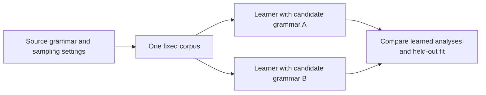

# Source and learner declarations

A synthetic corpus is generated under a known grammar, but the learner need
not be told that grammar. This permits a recovery test: give candidate learners
the same sentences, then compare what they infer with the source that produced
them. The source and learner declarations control opposite sides of that test:

Both arrows out of the corpus denote reuse of the same data. Changing a
learner should not silently change the evidence it receives. The
[corpus generation guide](../how-to/data/generate-a-synthetic-corpus.md)
and [comparison tutorial](../tutorials/06-compare-grammars.md) show the
corresponding declarations.

## Two declarations, two owners

A synthetic dataset carries its own grammar. Under
[`data.datasets.train.dataset`](../how-to/data/generate-a-synthetic-corpus.md), a `synthetic` corpus declares the grammar its
strings are drawn from, with its lexicon, and a [`synthetic-inference` dataset](../how-to/data/generate-inference-pairs.md)
declares the grammar and a source semantics (a language and an interpretation)
used only to draw strings and label their relations. The learner's grammar and
logical form language are declared under [`model.language`](../reference/configuration/language.md). The learner may
take its language from the data, as [the first tutorial's document](../tutorials/01-first-run.md) does, or
declare its own, which may name the same packaged fragment as the source or a
different one.

Recovery comparisons need a fixed corpus across candidate learners. Coupling
the source and learner grammars would change the corpus with each candidate,
confounding differences in the data with differences in the grammatical
assumption. Separate declarations let the experiment hold the source and
resolved corpus seed fixed, giving each learner the same strings and labels. A
synthetic dataset's seed draws equal corpora from equal resolved seeds and
source declarations, independently of the learner treatment, and `seed:
derived` takes a point-specific seed, so it can change the corpus across
learner treatments as well as across sweep seeds. Match resolved corpus seeds
or reuse a fixed corpus when the comparison requires identical data.
The L2 experiment crosses each source fragment with each candidate logic
without changing the corpus a row compares, and the L1 experiment uses a
lexical interpretation only to synthesize labeled pairs and held-out gold
forms; its learner receives pair tokens and [inference labels](inference-as-evidence.md#a-label-is-a-pair-of-proof-questions) and no semantic
constraint.

## Interventions

Write $G_0$ for the fixed source grammar, $D$ for a random derivation,
$W=\operatorname{yield}(D)$ for its string, and $Y$ for an oracle label.
The source defines a joint law $p_{G_0}(d,w,y)$ through its length,
derivation, lexical, and labeling procedures. A learner family
$\{p_{\boldsymbol{\theta},G}:\boldsymbol{\theta}\in\Theta_G\}$ is separate.
Holding $p_{G_0}$ fixed permits a comparison of learner grammars on the same data.

For positive length bounds $a\leq b$, uniform lengths have
$p(n)=1/(b-a+1)$ on $\{a,\ldots,b\}$. A tabular law normalizes its
declared nonnegative weights. The [negative binomial declaration](../how-to/data/generate-a-synthetic-corpus.md) uses
$N=a+K$ with shape $r>0$ and success parameter $\pi\in(0,1)$:

$$
p_K(k)=\frac{\Gamma(k+r)}{\Gamma(r)\,k!}\pi^r(1-\pi)^k,
\quad k\in\mathbb{N}_0,
\qquad
\mathbb{E}[N]=a+\frac{r(1-\pi)}{\pi}.
$$

The declaration calls $\pi$ `p`. Resampling above $b$ conditions this law on
$N\leq b$; clipping moves its upper-tail mass to $b$; `error` refuses the
draw. Their realized means need not equal the unbounded mean above.

If the maximum is six words and a draw requests eight, clipping produces a
six-word request. Resampling discards the eight-word request and draws again;
the replacement might have any permitted length. Clipping consequently adds
mass at the maximum, while resampling redistributes it across all accepted
lengths. Thus the same upper bound admits different realized distributions.

Filtering for an acceptance event $A$, such as a shape or semantic complexity
band, changes a proposal PMF $p$ to
$p_A(x)=p(x)\mathbf{1}_A(x)/\mathbb{P}(A)$ when acceptance is possible and
rejection sampling finishes. A finite attempt limit can prevent the requested
sample size from being reached. Report target bands with rejection counts
and realized distributions.

Interventions change declared properties of the source. The synthetic
declarations expose these families:

| Intervention | What it changes |
| --- | --- |
| [Length law](../how-to/data/generate-a-synthetic-corpus.md) | The distribution of sentence lengths: uniform, negative binomial with a declared out-of-support policy, or tabular. |
| [Derivation sampler](../how-to/data/generate-a-synthetic-corpus.md) | The local mass of each rule application: uniform, or weighted by rule name. Weights that omit or add a compiled rule are refused. |
| [Shape, ambiguity and scope targets](../how-to/data/generate-a-synthetic-corpus.md) | Bands on depth, branching, slash balance, lexical and derivational ambiguity, and scope readings, each sought within a declared number of attempts. |
| [String corruption](../how-to/data/corrupt-strings.md) | A proportion of items edited by weighted `swap`, `deletion`, `insertion` and `substitution` operators. |
| Negative data regime and label noise | Whether corrupted items are labeled negatives, absent (positive-only), or flipped, and at what rates grammatical and ungrammatical labels are observed wrongly. |
| Ill-typed [logical forms](logical-forms-as-types.md#semantic-typing) | A proportion of grammatical items whose form is corrupted into one the type checker refuses, by argument swap, over-application or sort mismatch. |
| [Inference pair design](../how-to/data/generate-inference-pairs.md) | Premise and hypothesis lengths, logical form complexity controls, label proportions, pairing by independence or predicate overlap, trivial and entailment relations, and label noise with a uniform or tabular confusion. |
| [Resembling lexicon](../how-to/grammars/declare-a-lexicon.md) | A lexicon drawn from the joint distribution a measured source was estimated to have. |

Each changes the realized training data. The experiments' records thus
report achieved values beside requested ones: the S3 analyses use achieved
shape and ambiguity rather than treating requested settings as observations,
and the L3 and L4 confusion reports record achieved labels conditional on
oracle labels rather than inferring noise from the requested rate. The requested rate defines the treatment; the realized rate measures its
outcome.

For oracle label $Y$ and observed label $\widetilde Y$, a confusion matrix
$\mathbf{C}$ has entries $c_{ab}=\mathbb{P}(\widetilde Y=b\mid Y=a)$,
where $c_{ab}\geq0$ and $\sum_b c_{ab}=1$. It induces
$p_{\widetilde Y}(b)=\sum_a c_{ab}p_Y(a)$. An edit probability is a different
intervention: an edited string can remain grammatical. The negative data
policy determines whether an oracle check or an assumed negative label
follows the edit.

Deleting *quickly* from *John runs quickly*, for instance, can leave a
grammatical sentence. A candidate must receive a nonderivability certificate from the configured
parser before it counts toward the requested corruption share.
[String corruption](../how-to/data/corrupt-strings.md) specifies how the edited
string is labeled, including the [distribution and certification rules](../how-to/data/corrupt-strings.md#declare-a-corruption).

## From intervention to factor

For two source settings $s_1,s_2$ and two learner settings $g_1,g_2$, a full
cross tests the Cartesian product

$$
\{s_1,s_2\}\times\{g_1,g_2\}
=\{(s_1,g_1),(s_1,g_2),(s_2,g_1),(s_2,g_2)\}.
$$

Yoking the axes instead selects corresponding pairs, $(s_1,g_1)$ and
$(s_2,g_2)$. Crossing can compare learners within each source; the yoked
design alone cannot separate a source change from a learner change.
[Sweep declarations](../how-to/experiments/sweeps.md)
determine which combinations run.
An experiment's sweep declares axes over leaves or configuration groups and
crosses them by a declared design: a full grid, a random or Latin hypercube
sample, or a fractional factorial of at least resolution IV. Yoked axes advance
together, so a source and the candidate that matches it can be paired rather
than crossed. A preregistered factor is bound to an axis through the
experiment's [`factors`](../reference/run.md#lofi.run.Experiment.factors) map, which names, for each level, the axis value that
realizes it; the S1 document, for instance, maps the levels `uniform` and
`negative-binomial` of a length law factor to two complete length declarations.
A document is refused if it binds a factor the [preregistration](experiments-and-commitments.md#preregistration) does not
declare, leaves a factor without an axis, leaves a level unmapped, or maps a
level to a value its axis does not take. An intervention is a factor only when
this binding exists; otherwise it is a setting.

## Does the source grammar win?

The source comparison reducer answers the question per source and data size.
It scores each candidate by held-out fit minus a description length charge per
held-out unit, so that a candidate that contains the source cannot win by
inclusion alone. It refuses a comparison group whose candidates differ in
measured parameter count, requires each candidate’s inventory to remain
consistent across its observations, and requires a primary fit
for the source arm and shared seeds across candidates.

For candidate $g$ and seed $j$, let $\ell_{g,j}$ be mean held-out fit,
$c_{g,j}$ the description length total, and $n_{g,j}>0$ the held-out unit
count. The reducer compares

$$
s_{g,j}=\ell_{g,j}-\frac{c_{g,j}}{n_{g,j}},\qquad
d_{g,j}=s_{G_0,j}-s_{g,j}.
$$

This penalized criterion is motivated by description length
\citep{rissanen1978}. The cost and fit metric must use compatible units;
statistical consistency and recovery require justification under the declared
candidate family and sampling procedure.

For each other candidate it runs a paired permutation test of the source's
scores against the candidate's and an equivalence test at the preregistered
margin, and it tests two validity controls, a reversed ground truth and a
scrambled lexicon, against the source. The contrasts in a group are corrected
with the experiment's declared correction at the declared level. The source must also beat each
of its capacity-matched signature twins. The verdict is positive only when the
source ranks first by mean score, beats every candidate and its twins, and
both controls pass. Otherwise the reducer classifies the winner as the source,
a simpler grammar, a richer one or a differently directed one, and it reports
the first data size at which the verdict becomes positive.

A positive verdict says that, under the declared candidates, description length
charge, capacity match and data distribution, the source was selected and the
alternatives lost. Extending this recovery claim to further candidates or
data distributions requires comparisons covering them. A negative verdict
uses the same scope, with the winner class recording the direction of the
selection error.
To run a comparison, see the [comparison
tutorial](../tutorials/06-compare-grammars.md) and [Reduce and report
results](../how-to/experiments/reduce-and-report-results.md); to generate the
data, see [Generate a synthetic
corpus](../how-to/data/generate-a-synthetic-corpus.md).

## References

\bibliography
