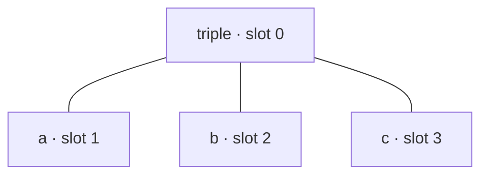

# Term layout capability is not an arity ceiling

This page explains why the arity of the terms LoFI can represent and the arity
a particular neural family can parameterize are two separate questions. A
**layout capability** determines how a term is laid out in slots. A
**rank family capability** determines which operator arities a neural family
has declared parameters for. Using an n-ary [term algebra](logical-forms-as-types.md#signatures-and-terms) with a neural component
requires checking that the layout represents its operators and the component
parameterizes their ranks.

## A tree and its representation

An operator's **arity** is the number of arguments it takes; *rank* has the
same meaning here. The term $\operatorname{triple}(a,b,c)$ has a root with
arity three and three leaves with arity zero. A layout describes where
those nodes are stored. For instance, visiting a node before its children
(preorder) visits `triple`, then $a$, then $b$, then $c$:

Each edge connects an operator to one argument. The root is at depth zero;
its three children are at depth one. The slot numbers record traversal
order, while the edges retain the parent–child relationships. A
[symbolic codec](../reference/terms.md#lofi.terms.TermCodec) must recover the tree from a valid encoding. A [neural encoder](../how-to/models/configure-term-encoders-and-decoders.md)
learns a numerical representation, and its decoder need not recover every
input perfectly. Separately, a neural component may have parameters for
combining two children but none for combining three. The tree can be valid
even when that component cannot process it.

## Terms, slots, and vector representations

Let $\Sigma$ be a ranked signature, $a(c)\in\mathbb{N}_0$ the arity of
constructor $c$, and $T_\Sigma$ its set of well-formed terms
\citep{meinke-tucker1992}. A finite layout serves a subset
$\mathcal{T}\subseteq T_\Sigma$. Its symbolic encoder and decoder satisfy

$$
\operatorname{enc}:\mathcal{T}\to\mathcal{E},\qquad
\operatorname{dec}:\operatorname{enc}(\mathcal{T})\to\mathcal{T},\qquad
\operatorname{dec}(\operatorname{enc}(t))=t.
$$

Here $\mathcal{E}$ contains the slot arrays: constructor indices, parent
indices, depths, occupancy, and any payloads. The equation concerns valid
encodings and the same signature. Arbitrary arrays must first satisfy the
encoding's validity conditions.

For a preorder layout with capacity $m$, the admissibility condition is
$|t|\leq m$, where $|t|$ counts nodes. The constructor's declared arity
determines how many following subtrees belong to it; parent and depth channels
record that structure explicitly. A preorder slot need not denote the same
tree path in two different terms.

For a complete tree layout, let $C$ be the reached constructors. The
implementation chooses $b=\max(\{2\}\cup\{a(c):c\in C\})$ and a declared
number of levels $d\geq1$. It allocates

$$
m=\sum_{j=0}^{d-1}b^j=\frac{b^d-1}{b-1}
$$

slots. The root has depth zero, so a term fits when every node has depth
less than $d$ and arity at most $b$. In heap coordinates, child $j$ of
position $i$ occupies $bi+j$ for $1\leq j\leq b$; depth-first and
breadth-first orders permute these fixed positions. Thus a small term may
still overflow a complete tree layout if it is too deep.

For instance, a complete binary layout with three levels allocates seven
positions: one root, two children, and four grandchildren. A four-node unary
chain is still too deep because its last node has depth three. A four-node
tree whose deepest node has depth two can fit, provided each node has at most
two children. Node count, depth, and arity thus constrain different
features of a representation.

A neural encoder instead maps a term to a vector,
$e_{\boldsymbol{\theta}}:\mathcal{T}\to\mathbb{R}^{h}$, and a neural decoder
assigns locally normalized choice probabilities and induced complete term
weights $w_{\boldsymbol{\theta}}(t\mid\mathbf{z})$. These weights normalize
over admitted terms only when every positive-weight path completes in an
admitted term; otherwise they form a subprobability mass function. Recovery
with probability one under the decoder distribution, $w_{\boldsymbol{\theta}}(t\mid e_{\boldsymbol{\theta}}(t))=1$, or injectivity
of the learned representation would require additional conditions beyond the
symbolic round trip. Binding and superposition have a separate
history in distributed representations \citep{smolensky1990,plate1995}.

LoFI's holographic [term encoder](../how-to/models/configure-term-encoders-and-decoders.md#choose-an-encoder) uses coordinatewise multiplication, rather
than the circular convolution in \citealt{plate1995}. With slot role
$\mathbf{r}_i\in\mathbb{R}^{h}$ and constructor code
$\mathbf{c}_{o_i}\in\mathbb{R}^{h}$, its node recurrence is

$$
\mathbf{z}_i=\mathbf{r}_i\odot\mathbf{c}_{o_i}
+\begin{cases}
\displaystyle\frac{1}{\sqrt{k_i}}\sum_{j\in\operatorname{ch}(i)}\mathbf{z}_j,
&k_i>0,\\
\mathbf{0},&k_i=0,
\end{cases}
$$

where $k_i$ is the number of occupied children and $\odot$ is the Hadamard
product. Unoccupied slots contribute zero. Dividing a single binding by a
nonzero role recovers its filler coordinatewise; dividing a superposition
also leaves contributions from the other bindings. Exact neural recovery
thus depends on how those contributions are resolved, in addition to
compatibility of the encoder and decoder.

## Supported paths

The package exercises these paths with a signature containing a ternary
constructor:

| Layout | Supported neural pairing | Why the pairing works |
| --- | --- | --- |
| Preorder with arity | Holographic [term encoder](../how-to/models/configure-term-encoders-and-decoders.md#choose-an-encoder) and holographic [term decoder](../how-to/models/configure-term-encoders-and-decoders.md#choose-decoders) | The codec records the constructor symbols and parent channels directly. Holographic components bind and unbind slot roles, so they do not require term-independent tree paths. |
| Complete tree | Holographic term encoder and recursive term decoder | The layout computes its branching factor from the operators the grammar reaches. A reached ternary constructor thus supplies three child positions to the decoder, and the holographic encoder supplies the decoder's input representation and width. |

Both paths use the ordinary layout declarations and component factories. Each
encodes, decodes and assigns a finite score to a term whose root has three
children.

## Where a rank limit applies

Some neural families allocate separate parameters by operator rank. These
families declare an [`ArityBound`](../reference/nn.md#lofi.nn.arity.ArityBound). Construction compares the arities the grammar
reaches with that declaration. If a declaration covers ranks one and two but
the grammar reaches the ternary constructor `triple`, construction raises
[`ArityUnsupportedError`](../reference/nn.md#lofi.nn.arity.ArityUnsupportedError) and names both `arity 3` and `triple`.

Formally, if $R_+=\{a(c):c\in C,\ a(c)>0\}$ is the set of reached positive arities and
$A\subseteq\mathbb{N}_{>0}$ the family's supported arities, construction
requires $R_+\subseteq A$. Nullary constructors need no combination module.
This is a condition on the component's parameter
families, independent of the layout's node or depth bound.

The refusal identifies the rank-indexed declaration that lacks the required
parameters. The ternary term and its preorder and complete tree encodings
remain valid under their bounds, as do the supported decoder paths above. Widening such a family requires it to declare
and provide parameters for the additional rank; the layouts need no new arity
mechanism.

## Why the distinction matters

A comparison between grammars that reach different operator arities is a
comparison only if every arm runs under a component that serves its arities.
Because the rank limit is declared and checked at construction, an arm that
exceeds it is refused rather than run under a degraded representation, and the
refusal names the component responsible. The same principle governs rule
arities in the chart, through deduction profiles (see [Grammars as deductive
systems](derivations-as-proofs.md) and [Swappable grammatical
assumptions](swappable-assumptions.md)). To choose a layout and a
component pairing, see [Configure term encoders and
decoders](../how-to/models/configure-term-encoders-and-decoders.md).

## References

\bibliography
