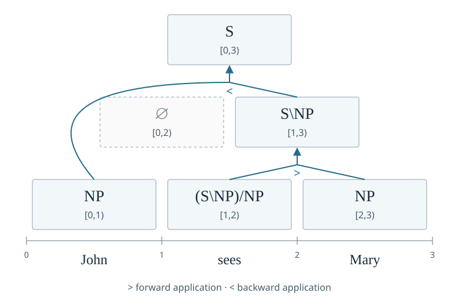

# Configure a chart parser

A run declares its charts in two places. `model.parser` is the neural chart:
it builds a vector for every span from the pooled word rows, weighs the
grammar's actions with the [controller](configure-a-controller.md#scores-and-action-probabilities), and publishes the chart quantities that
readouts and losses read. The top-level `parse` section is the symbolic chart
algorithm the run uses for its symbolic parses, under a [semiring](../../explanation/charts-and-approximation.md#what-a-semiring-decides), an optional
[pruner](../../explanation/charts-and-approximation.md#pruning) and a traversal strategy. A third section, `approximation`, bounds the
probability mass any truncating component may leave out. This guide
configures all three and shows how each is refused.

The examples compose
[`docs/examples/synthetic-parser.yaml`](https://github.com/logical-form-induction/lofi/blob/main/docs/examples/synthetic-parser.yaml),
whose `defaults` select `model.parser: inside-outside` and which declares:

```yaml
parse: {retain: forest, reachability: all}
approximation: {residual_mass: 0.75}
```

The setup the examples share:

```python
from pathlib import Path

from lofi.spec import ConfigValueError, RunSpecCodec, config_search_path, load_plugins

load_plugins()
codec = RunSpecCodec(search_path=config_search_path(Path.cwd()))
document = Path("docs/examples/synthetic-parser.yaml")
```

## Read the composed chart

```python
run = codec(document)
parser = run.model.parser
print(parser.kind, parser.width, parser.attend, parser.reduction)
print(parser.composition)
print(sorted(parser.chart_outputs()))
```

```text
inside-outside 4 MarginalSplitWeigherSpec(kind='marginal') LogSumExpReductionSpec(kind='log-sum-exp')
MeanFieldCompositionSpec(kind='mean-field', leaf=MlpSpanFunctionSpec(kind='mlp', layers=1, activation='tanh'), cell=MlpSpanFunctionSpec(kind='mlp', layers=1, activation='tanh'))
['actions', 'alpha', 'cells', 'identity', 'inside', 'log_z', 'mu', 'outside', 'outside_cells', 'spans']
```

The width of 256 comes from the packaged fragment
[`lofi/configs/model/parser/inside-outside.yaml`](https://github.com/logical-form-induction/lofi/blob/main/lofi/configs/model/parser/inside-outside.yaml), which declares
`{kind: inside-outside, width: 256, attend: {kind: marginal}}`. The chart's
outputs are what a readout or loss may name; the next section shows how the
choice of chart changes them.
## Choose the chart family

A [chart](../../explanation/charts-and-approximation.md#reusing-partial-analyses) stores information about contiguous pieces of a sentence so that
larger pieces can reuse smaller ones. For a hypothetical three-word sentence,
the two binary groupings are `((w1 w2) w3)` and `(w1 (w2 w3))`. Both use
word-sized pieces, but they disagree about the intermediate two-word span.
A neural span vector represents a piece; a split score expresses a preference
for one way of combining its children.

Charts register under the `lofi.chart` [entry point group](../../reference/entry-points.md#registered-groups-and-names):

| `kind` | What it is | Own fields |
| --- | --- | --- |
| [`inside-outside`](../../reference/configuration/model.md#lofi.spec.parsers.chart.InsideOutsideParserSpec) | A chart scored by an inside and an outside sweep over span vectors. | [`width`](../../reference/configuration/model.md#lofi.spec.parsers.chart.InsideOutsideParserSpec), `composition`, `reduction`, `attend`, `split_left`, `split_right`, `share_splits`, `transition`, `depth`, `layer_sharing`, `outside_weights`, `root_outside`, `root_init_gain`. |
| [`tagged`](../../reference/configuration/model.md#lofi.spec.parsers.tagged.TaggedParserSpec) | A chart refined by category and [normal form](../../explanation/derivations-as-proofs.md#normal-forms), whose cells follow the compiled grammar's transitions. | `width`, `composition`, `reduction`, `attend`, `split_left`, `split_right`, `share_splits`, `outside_weights`, `root_outside`, `root_init_gain`, [`unary_depth`](../../reference/configuration/model.md#lofi.spec.parsers.tagged.TaggedParserSpec) (rounds of unary rules within each cell) and `k_best` (derivations retained, default 1). |
| [`span-crf`](../../reference/configuration/model.md#lofi.spec.parsers.span_crf.SpanCrfParserSpec) | A conditional random field over binary span trees with scalar potentials. It stores no chart vectors, has no [controller](configure-a-controller.md#scores-and-action-probabilities) dependency and always reduces by log-sum-exp. | `hidden`, the width of the layer that scores splits. |
| [`flat`](../../reference/configuration/model.md#lofi.spec.parsers.flat.FlatParserSpec) | A span encoder that represents each span from its endpoint words. | `width`, `features` (from `left`, `right`, `bilinear`, nonempty and without repeats) and `projection_initialization` (`identity` or `xavier-uniform`). |

Replace the chart with a tagged one, as the S1 experiment's common run
document does:

```python
tagged = codec(
    document,
    overrides=(
        'model.parser={"kind": "tagged", "width": 8, "unary_depth": 2, "k_best": 4}',
    ),
)
print(
    tagged.model.parser.kind,
    tagged.model.parser.unary_depth,
    tagged.model.parser.k_best,
)
print(sorted(tagged.model.parser.chart_outputs()))
```

```text
tagged 2 4
['actions', 'alpha', 'cells', 'identity', 'inside', 'log_z', 'mu', 'outside_cells', 'spans']
```

A chart must publish every output the model's readouts require. The synthetic
parser's `category-terms` readout reads chart cells, which a span CRF does not
store, and its `types` readout reads `alpha` and `mu`, which a flat encoder
does not publish. Both replacements are refused before anything is built:

```python
from lofi.spec import ConfigDocumentError

for parser in (
    '{"kind": "span-crf", "hidden": 8}',
    '{"kind": "flat", "width": 4, "features": ["left", "right"], "projection_initialization": "identity"}',
):
    try:
        codec(document, overrides=(f"model.parser={parser}",))
    except ConfigDocumentError as refused:
        print(str(refused).split(": ", 1)[1])
```

```text
model.parser: the 'span-crf' parser publishes chart outputs ['alpha', 'entropy', 'inside', 'log_z', 'mbr', 'mu', 'outside'], but model.readouts.category-terms requires ['cells']
model.parser: the 'flat' parser publishes chart outputs ['cells', 'inside'], but model.readouts.types requires ['alpha', 'mu']
```
## Scalar tree distributions

Scores become probabilities only after normalization over the alternatives
under consideration. If two hypothetical trees have ordinary weights three
and one, their probabilities are three quarters and one quarter. The [partition
function](../../explanation/charts-and-approximation.md#inside-outside-and-marginals) below is that total weight, generalized to all admitted binary trees.
Changing which trees are admitted can change every normalized probability even
when their individual scores stay fixed.

Under application alone, the following chart has a verb–object constituent
in `[1,3)` and a complete sentence in `[0,3)`. The cell `[0,2)` remains empty:
`NP` followed by `(S\NP)/NP` cannot combine by either application rule. Each
arrow uses the categories in two smaller cells to fill a larger one.



For a string $\mathbf{w}$ of length $n$, let $\mathcal{T}_n$ be its binary
span trees. A span CRF assigns a real leaf potential $\lambda_i$ and a real
split potential $s_{ikj}$ to $[i,j)$ split at $k$. Its tree PMF is

$$
p(t\mid\mathbf{w})=\frac{\exp\ell(t)}{z(\mathbf{w})},\qquad
\ell(t)=\sum_{i=0}^{n-1}\lambda_i+
\sum_{(i,k,j)\in t}s_{ikj},\qquad
z(\mathbf{w})=\sum_{t\in\mathcal{T}_n}\exp\ell(t).
$$

LoFI scores a split from its two spans' mean word vectors:
$s_{ikj}=\mathbf{v}^{\mathsf T}\tanh(\mathbf{W}_{l}\overline{\mathbf{x}}_{ik}
+\mathbf{W}_{r}\overline{\mathbf{x}}_{kj})+b$.
For $T\sim p(\cdot\mid\mathbf{w})$, inside–outside computes $\log z$, span probabilities
$\mu_{ij}=\mathbb{P}([i,j)\in T\mid\mathbf{w})$, and split probabilities
conditioned on the parent span. These marginals are differentiable functions
of the potentials \citep{kim-etal2017}. The entropy is
$h(T\mid\mathbf{w})=-\sum_t p(t\mid\mathbf{w})\log p(t\mid\mathbf{w})$.
An inside score is an unnormalized log weight; neither it nor $\log z$ is
itself a log probability. See [Charts and approximation](../../explanation/charts-and-approximation.md)
for the recurrences and [minimum Bayes risk](../evaluation/decode-derivations.md#choose-the-decision-rule) decoding.

## Compose spans and weigh splits

The neural charts share four declared parts:

| Field | What it declares |
| --- | --- |
| `composition` | How leaves enter the chart and two child cells make a parent, from the `lofi.chart_composition` group. `mean-field` (the default) composes each child pair directly before mixing over splits, with `leaf` and `cell` functions. `gated-residual` gates a composed `candidate` against the mean of the two children with a `gate` function. |
| `attend` | How a span's candidate splits are mixed, from the `lofi.split_weigher` group. `marginal` (the default) uses each split's exact conditional posterior under the chart. `attend` uses learned child pair scores alone, from its `score` function. |
| `reduction` | How alternative derivations combine: `log-sum-exp` (the default) sums their nonnegative weights in log space, and `maximum` keeps the largest. |
| `split_left`, `split_right`, `share_splits` | The functions that project the left and right children of a split, and whether one projection serves both. Shared slots must declare the same function. |

For child cells $\mathbf{h}_{ik},\mathbf{h}_{kj}\in\mathbb{R}^{d}$, direct
composition produces $\mathbf{c}_{ikj}=f(\mathbf{h}_{ik},\mathbf{h}_{kj})$.
Gated residual composition instead uses

$$
\begin{aligned}
\mathbf{g}_{ikj}&=\sigma\!\left(g(\mathbf{h}_{ik},\mathbf{h}_{kj})\right),\\
\mathbf{c}_{ikj}&=\mathbf{g}_{ikj}\odot f(\mathbf{h}_{ik},\mathbf{h}_{kj})
+(\mathbf{1}-\mathbf{g}_{ikj})\odot
\frac{\mathbf{h}_{ik}+\mathbf{h}_{kj}}2,\\
\mathbf{h}_{ij}&=\sum_{k=i+1}^{j-1}q_{ikj}\mathbf{c}_{ikj}.
\end{aligned}
$$

Here $\sigma(x)=1/(1+\exp(-x))$ is the logistic sigmoid, applied
coordinatewise. Under `marginal`, $q_{ikj}$ is the
conditional split posterior; under `attend`, it is softmax over learned local
split scores, which can differ from the structural posterior. Under
`mean-field`, composition applies $f$ to averaged child vectors. For nonlinear
$f$, this can differ from averaging the compositions of individual child
trees, so the resulting vector approximates that expectation.

A full bilinear span function has coordinates
$c_o=\mathbf{u}^{\mathsf T}\mathbf{B}_o\mathbf{v}+b_o$.
Its CP-factorized counterpart is

$$
\mathbf{c}=\mathbf{W}\bigl((\mathbf{U}\mathbf{u})\odot
(\mathbf{V}\mathbf{v})\bigr)+\mathbf{b},
$$

where $\mathbf{U}$ and $\mathbf{V}$ have $r$ rows and
$\mathbf{W}\in\mathbb{R}^{d_{\mathrm{out}}\times r}$; `rank` sets $r$.
This constrains the three-way coefficient tensor's CP rank to at most $r$
\citep{kolda-bader2009}. The `hrr` function uses either elementwise binding
$\mathbf{u}\odot\mathbf{v}$ or circular convolution,
$c_i=\sum_{j=0}^{d-1}u_jv_{(i-j)\bmod d}$ \citep{plate1995}.

Every function slot takes a span function from the `lofi.span_function` group,
and each defaults to a one-layer `mlp` under `tanh`:

| `kind` | Computes | Fields |
| --- | --- | --- |
| `mlp` | Affine maps and an activation over the concatenated inputs. | `layers`, `activation`. |
| `gated-mlp` | An interpolation of a candidate and a residual projection under a learned gate. | `layers`, `activation`. |
| `bilinear` | A full bilinear map of exactly two inputs. | None. |
| `cp-bilinear` | A CP-factorized bilinear map of exactly two inputs. | `rank`. |
| `hrr` | A holographic binding of two equal-width vectors. | `binding` (`hadamard` or `circular`). |
| `transformer` | A self-attentive block over the projected inputs. | `layers`, `heads`, `feedforward_width`, `activation`, `dropout` (default `0.0`, in `[0, 1)`) and `norm_placement` (`pre` or `post`, the default: whether each sublayer normalizes its input or its residual sum). |

The `inside-outside` chart can also stack: `depth` above one runs several
inside-outside layers with a `transition` function between them, one per
layer under `layer_sharing: independent` or a single shared one under
`shared`. `outside_weights: contextual` (the default) weighs each span's
possible contexts by their parent posterior, and `reuse` reuses the inside
split weights. `root_outside` places a `learned` vector (the default) or a
`zero` vector at each item's root span. A learned root is drawn with standard
deviation `root_init_gain` over the square root of the width; the gain is
positive, defaults to `1.0`, and is refused under a `zero` root.

The choice of split weigher and reduction decides which [controller](configure-a-controller.md#scores-and-action-probabilities) inputs the
chart offers: `span` is available only under `attend` with `log-sum-exp`
([Configure a controller](configure-a-controller.md) shows the refusal).
Two other combinations are refused at composition:

```python
for overrides in (
    ("model.parser.depth=2", 'model.parser.reduction={"kind": "maximum"}'),
    ("model.parser.share_splits=true", 'model.parser.split_left={"kind": "bilinear"}'),
):
    try:
        codec(document, overrides=overrides)
    except ConfigValueError as refused:
        print(refused)
```

```text
model.parser was refused: a stacked neural chart requires log-sum-exp inside-outside readouts
model.parser was refused: shared split slots must declare the same span function
```

## Declare the symbolic parse

The `parse` section is composed with every run:

```python
print(run.parse)
```

```text
ParseSpec(retain='forest', reachability='all', strategy=CkyStrategySpec(kind='cky'), span_index=ContiguousSpanIndexSpec(kind='contiguous'), chart_store=NativeChartStoreSpec(kind='native'), pruner=None, semiring=LogInsideSemiringSpec(kind='log-inside'), measure_pruned_mass=False, refinement_pairs=65536)
```

| Field | What it says |
| --- | --- |
| `retain` | `forest` keeps the packed derivation steps; `inside` keeps only the [inside weights](../../explanation/charts-and-approximation.md#inside-outside-and-marginals). Required. |
| `reachability` | `all` constructs every chart item; `roots` constructs only items that reach a root. Required. |
| `refinement_pairs` | Under `reachability: roots`, the maximum number of pairs of bindings and candidates the reachability plan enumerates when it narrows one rule's demands on its one-token children (default 65536). A rule past the bound keeps its wider demands, so a lower bound plans faster and prunes less, without losing an item that reaches a root; `0` never narrows. Another value under `reachability: all` is refused. |
| [`semiring`](../../reference/configuration/components.md#lofi.spec.components.run.ParseSpec) | From the `lofi.semiring` group; the table below lists the packaged ones. `log-inside` is the default. |
| `pruner` | From the `lofi.cell_pruner` group: `null` (the default), or `top-k`, which keeps the [`width`](../../reference/configuration/components.md#lofi.spec.components.run.TopKPrunerSpec) heaviest items of each cell and prunes lexical cells only under `prune_lexical: true`. |
| `measure_pruned_mass` | `false` (the default), or `true` to repeat each pruned parse without its [pruner](../../explanation/charts-and-approximation.md#pruning) and report the goal probability mass the pruner removed. It needs a pruner and a [semiring](../../explanation/charts-and-approximation.md#what-a-semiring-decides) with posterior marginals. |
| `strategy`, `span_index`, `chart_store` | The traversal, region index and storage, from the `lofi.parse_strategy`, `lofi.span_index` and `lofi.chart_store` groups. Each has one packaged variant: `cky`, `contiguous` (half-open spans) and `native` (packed forest and inside table storage). |

The packaged fragments under [`lofi/configs/parse/`](https://github.com/logical-form-induction/lofi/tree/main/lofi/configs/parse/) are `exhaustive`, which
spells out the defaults, and `viterbi-beam`, which selects the [Viterbi](../evaluation/decode-derivations.md#choose-the-decision-rule)
semiring and an eight-wide top-k pruner. Select the second from the root of the
document:

```python
beam = codec(document, overrides=("/parse=viterbi-beam",))
print(beam.parse.semiring, beam.parse.pruner)
```

```text
ViterbiSemiringSpec(kind='viterbi') TopKPrunerSpec(prune_lexical=False, kind='top-k', width=8)
```

On the command line the same selection is `--set /parse=viterbi-beam`.

## Choose a semiring

A [semiring](../../explanation/charts-and-approximation.md#what-a-semiring-decides) specifies how partial results combine and how competing analyses
are aggregated. The intended question determines the useful operations:
existence asks whether any derivation succeeds; [Viterbi](../evaluation/decode-derivations.md#choose-the-decision-rule) asks for the best
score; inside summation asks for total weight across derivations. A component
that needs probabilities over alternatives requires a semiring that retains
their summed weights; the capability checks enforce this requirement.

Every packaged semiring may be the run's parse. Each declares the
capabilities its weights have, and a component that needs a capability the
declared semiring lacks is refused when the run is composed:

| `kind` | Own fields | Capabilities |
| --- | --- | --- |
| `log-inside` | None. | `log-probability`, `marginals` |
| `viterbi` | None. | `log-probability` |
| `counting` | None. | None. |
| `boolean` | None. | None. |
| `k-best` | `k`, the number of derivation log probabilities kept. | None. |
| `expectation` | `dimensions`, the number of expectation coordinates. | None. |
| `forest` | None. | None. |

The `log-probability` capability supplies floating-point log weights, which the `top-k`
[pruner](../../explanation/charts-and-approximation.md#pruning) ranks and [A*](../../explanation/charts-and-approximation.md#a-widening) decoding bounds. `marginals` weights sum over every
derivation, which a minimum Bayes risk decode and [`measure_pruned_mass`](../../reference/configuration/components.md#lofi.spec.components.run.ParseSpec) read.
The Bisk--Hockenmaier baseline's own parse needs `log-probability` weights.
A semiring without them is accepted when nothing reads them:

```python
counting = codec(document, overrides=('parse.semiring={"kind": "counting"}',))
print(counting.parse.semiring, sorted(counting.parse.semiring.capabilities))
```

```text
CountingSemiringSpec(kind='counting') []
```

and refused, with a [`SemiringCapabilityError`](../../reference/spec.md#lofi.spec.SemiringCapabilityError) naming the capability, when a
component does:

```python
try:
    codec(
        document,
        overrides=("/parse=viterbi-beam", 'parse.semiring={"kind": "counting"}'),
    )
except ConfigValueError as refused:
    print(refused)
```

```text
parse was refused: the top-k pruner needs float log-probability weights, which parse.semiring 'counting' does not supply
```
## Measure what a pruner removed

[Pruning](../../explanation/charts-and-approximation.md#pruning) saves work by removing alternatives before all larger analyses are
built. A removed local alternative can participate in many complete trees.
Measuring their combined sentence mass requires an additional exhaustive
parse, which supplies the reference total under the same declared setup.

A pruned forest records, in its `pruned` mapping, the [semiring](../../explanation/charts-and-approximation.md#what-a-semiring-decides) sum of the
[inside weights](../../explanation/charts-and-approximation.md#inside-outside-and-marginals) each cell's pruner removed, next to its `truncated` flag.
Declaring `measure_pruned_mass: true` also reparses each sentence without the
pruner, and the pruned forest's `pruned_mass` then holds both goal log masses,
with the unnormalized goal mass the pruner lost as `lost` and its share of the
exhaustive mass as `lost_fraction`. The reparse costs an exhaustive parse per
sentence. It needs a sum over derivations, so it is refused under `viterbi`:

```python
measured = codec(
    document,
    overrides=(
        'parse.pruner={"kind": "top-k", "width": 8}',
        "parse.measure_pruned_mass=true",
    ),
)
print(measured.parse.build().measure_pruned_mass)

try:
    codec(document, overrides=("/parse=viterbi-beam", "parse.measure_pruned_mass=true"))
except ConfigValueError as refused:
    print(refused)
```

```text
True
parse was refused: measuring pruned mass needs posterior marginals, which parse.semiring 'viterbi' does not supply
```

## Bound the approximation

[`approximation.residual_mass`](../../reference/spec.md#lofi.spec.ApproximationSpec) is the probability mass, in `[0, 1)`, that any
truncating component may leave out, such as a readout that decodes at most a
capped number of terms. A truncating component may override it with its own
`residual_mass`; one that declares no override in a run without an
`approximation` section is refused. A bound of one is refused at composition:

```python
try:
    codec(document, overrides=("approximation.residual_mass=1.0",))
except ConfigValueError as refused:
    print(refused)
```

```text
approximation.residual_mass was refused: a residual mass bound lies in [0, 1), not at 1.0
```

The resolved bound and every override are recorded among the point's compile
metrics as `approximation-residual-mass` and `approximation-overrides`.

## See also

- [Configure readouts](configure-readouts.md) for what reads the chart outputs.
- [Configure a controller](configure-a-controller.md) for the policy the chart
  weighs actions with.
- [Charts and approximation](../../explanation/charts-and-approximation.md)
  for what each [semiring](../../explanation/charts-and-approximation.md#what-a-semiring-decides) and truncation licenses.
- [Charts and semirings](../../tutorials/07-charts-and-semirings.md) for a
  chart sweep run by hand.
- The [model configuration reference](../../reference/configuration/model.md)
  for every chart and span function field.

## References

\bibliography
