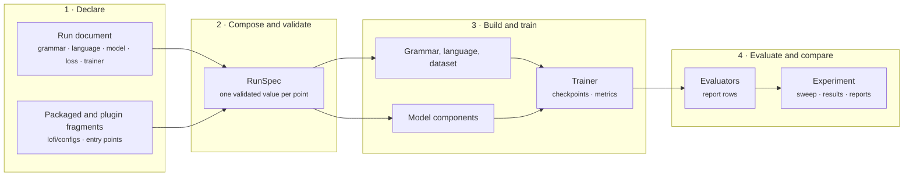

<div class="lf-home" markdown="block">

<section class="lf-hero" markdown="block">
<div class="lf-hero__copy" markdown="block">

# Induce categorial grammars and typed logical forms.

<p class="lf-hero__lede">LoFI treats a category as a type, a derivation as a proof, and a logical form as the proof term, so that grammatical assumptions can be declared, swapped, and compared within one implementation.</p>

<div class="lf-hero__actions">
  <a href="tutorials/01-first-run/" class="md-button md-button--primary">Run a first point</a>
  <a href="how-to/setup/installing/" class="md-button">Install LoFI</a>
</div>

</div>

<div class="lf-hero__code" markdown="block">

```yaml
grammar:
  formalism: declared
  signature:
    primitives: [S, NP, conj]
  rules:
    name: application
    rules:
      - {rule: application, view: /}
      - {rule: application, view: "\\"}
  lexicon:
    kind: inline
    entries:
      - {form: word-0, category: NP}
      - {form: word-1, category: "S\\NP"}
      - {form: word-2, category: "S\\NP/NP"}
  goal:
    categories: [S]
```

</div>
</section>

<nav class="lf-pathways" aria-label="Choose a documentation path" markdown="block">
<article class="lf-pathway" markdown="block">

## [Learn by running](tutorials/index.md)

Install LoFI, train one point from a run document, and work toward inducing a lexicon and its logical forms.

</article>
<article class="lf-pathway" markdown="block">

## [Do one task](how-to/index.md)

Declare a grammar or a language, generate data under an intervention, configure a model, or run an experiment.

</article>
<article class="lf-pathway" markdown="block">

## [Understand the design](explanation/index.md)

See what each grammatical and modeling family assumes and what a comparison between two declarations licenses.

</article>
<article class="lf-pathway" markdown="block">

## [Look something up](reference/index.md)

Find every command, entry-point group, configuration section, and public API.

</article>
</nav>

## One document per point

A LoFI run is declared by one document. Its sections name the grammar that
generates or reads the data, the logical-form language and interpretation, the
model components, the loss terms, the trainer, and the evaluators. Composition
resolves packaged fragments, profiles, overlays, and command-line overrides,
and validates the result once, as a `RunSpec`. The resolved document, not the
spelling of its inputs, identifies the point.

The grammar above is an excerpt of
[`docs/examples/synthetic-parser.yaml`](https://github.com/logical-form-induction/lofi/blob/main/docs/examples/synthetic-parser.yaml),
which the [first tutorial](tutorials/01-first-run.md) composes and trains. It
declares three primitive categories, forward and backward application, an
inline lexicon, and `S` as the goal.

## What composes

First, every grammatical assumption is a declared choice from a discoverable
family: the formalism, the category signature, the combinatory rules, the
normal form, the matching relation between categories, the goal, and the
lexicon. Each family registers its variants through a package entry point, so
a plugin adds a variant without editing LoFI.

Second, data and learner are declared separately. A synthetic dataset carries
the grammar and interpretation that generate it, together with its
interventions: length and rule distributions, string corruption, label noise,
ill-typed logical forms, and inference-pair designs. The learner declares its
own candidate grammar and language. Crossing the two in one experiment asks
whether the source grammar is the one recovered.

Third, the model is assembled from swappable components: token encoders, chart
parsers over spans, term encoders and decoders over declared spaces,
controllers, readouts, and losses. Inference pairs can ground the logical forms
through a theorem prover or through model checking. Every point records its
resolved document, its metrics, and its checkpoints, and an experiment reduces
its points' rows into declared reports.

## Architecture

The map separates what a user writes, what composition checks, what a point
builds and trains, and what an experiment reports. Read the arrows as the order
in which a run proceeds.



## Foundations

The categorial machinery follows the type-logical tradition, in which
categories are formulas and derivations are proofs ([Lambek,
1958](https://doi.org/10.1080/00029890.1958.11989160); [Moortgat,
1997](https://doi.org/10.1016/B978-044481714-3/50005-9)), and the combinatory
rules follow CCG ([Steedman,
2000](https://doi.org/10.7551/mitpress/6591.001.0001)). Logical
forms are proof terms in the sense of the formulae-as-types correspondence
(Howard, 1980, in *To H. B. Curry: Essays on Combinatory Logic,
Lambda Calculus and Formalism*, Academic Press). Parsing
is weighted deduction over a chart ([Shieber, Schabes, and Pereira,
1995](https://doi.org/10.1016/0743-1066(95)00035-I)), evaluated under a
semiring ([Goodman, 1999](https://aclanthology.org/J99-4004/)).

</div>
