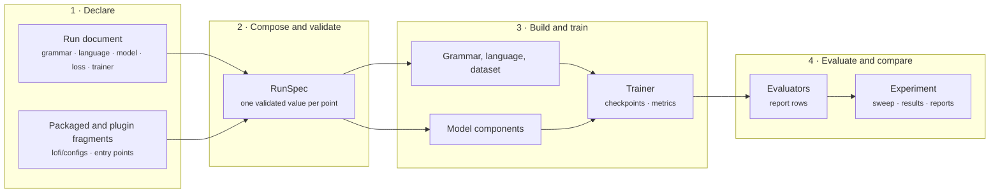

<div class="lf-home" markdown="block">

<section class="lf-hero" markdown="block">
<div class="lf-hero__copy" markdown="block">

# Learn how words combine and what they mean.

<p class="lf-hero__lede">LoFI is a research library for learning categorial grammars and typed logical forms from data. Declare competing assumptions about how words combine, train learners under those assumptions, and compare the structures and meanings they recover.</p>

<div class="lf-hero__actions">
  <a href="tutorials/01-first-run/" class="md-button md-button--primary">Run the first tutorial</a>
  <a href="how-to/setup/installing/" class="md-button">Install LoFI</a>
</div>

</div>

<div class="lf-hero__code" markdown="block">

```yaml
grammar:
  formalism: declared
  signature:
    primitives: [S, NP, conj]
  rules:
    name: application
    rules:
      - {rule: application, view: /}
      - {rule: application, view: "\\"}
  lexicon:
    kind: inline
    entries:
      - {form: word-0, category: NP}
      - {form: word-1, category: "S\\NP"}
      - {form: word-2, category: "S\\NP/NP"}
  goal:
    categories: [S]
```

</div>
</section>

<nav class="lf-pathways" aria-label="Choose a documentation path" markdown="block">
<article class="lf-pathway" markdown="block">

## [Learn by running](tutorials/index.md)

Install LoFI, run a small training example, and learn to read its results before changing the grammar.

</article>
<article class="lf-pathway" markdown="block">

## [Do one task](how-to/index.md)

Declare a grammar or a language, generate data under an intervention, configure a model, or run an experiment.

</article>
<article class="lf-pathway" markdown="block">

## [Understand the design](explanation/index.md)

Start with [words, types, and notation](explanation/reading-the-notation.md), then follow the formal definitions and the assumptions behind each comparison.

</article>
<article class="lf-pathway" markdown="block">

## [Look something up](reference/index.md)

Find every command, entry point group, configuration section, and public API.

</article>
</nav>

## One document per point

A LoFI run is declared by one document. Its sections name the grammar that
generates or reads the data, the [logical form language](how-to/grammars/declare-a-logical-form-language.md#declare-a-language-inline) and [interpretation](how-to/grammars/declare-an-interpretation.md#declare-the-datasets-interpretation), the
model components, the [loss terms](explanation/induction-objectives.md#what-training-is-asked-to-improve), the trainer, and the [evaluators](how-to/evaluation/evaluate-a-run.md#choose-an-evaluator-kind). [Composition](explanation/documents-are-the-dsl.md#composition)
resolves packaged fragments, [profiles, overlays, and command line overrides](how-to/setup/configuration.md#apply-a-profile-overlays-and-overrides),
and validates the result once, as a [`RunSpec`](reference/spec.md#lofi.spec.RunSpec).
The resolved document and the seed identify the point: inputs that resolve
to the same document share that identity when their seeds agree. A seed
initializes the random choices in the run. A [point](explanation/documents-are-the-dsl.md#point-identity)
thus fixes both the settings and the seed; it is the unit whose results are recorded.

The grammar above is an excerpt of
[`docs/examples/synthetic-parser.yaml`](https://github.com/logical-form-induction/lofi/blob/main/docs/examples/synthetic-parser.yaml),
which the [first tutorial](tutorials/01-first-run.md) composes and trains. It
declares three [primitive categories](how-to/grammars/declare-a-signature.md#declare-primitives-and-constructors), [forward and backward application](how-to/grammars/choose-combinatory-rules.md#the-rule-families), an
[inline lexicon](how-to/grammars/declare-a-lexicon.md#list-entries-inline), and `S` as the [goal](how-to/grammars/choose-normal-form-matching-goal.md#declare-a-goal).

For instance, `NP` can stand for a noun phrase and `S` for a sentence.
The category `S\NP` needs an `NP` on its left to produce an `S`: the pattern
used when *John* combines with *sleeps*. [Categories, semantic types, and
logical forms](explanation/logical-forms-as-types.md#start-with-a-sentence)
works through that combination and its meaning. The excerpt uses artificial
word names because the tutorial generates a [synthetic corpus](how-to/data/generate-a-synthetic-corpus.md#draw-the-corpus).

## What composes

First, every grammatical assumption is a declared choice from a discoverable
family: the [formalism](how-to/grammars/choose-a-formalism.md#the-packaged-formalisms), the [category signature](how-to/grammars/declare-a-signature.md#a-complete-signature), the [combinatory rules](how-to/grammars/choose-combinatory-rules.md#the-rule-families), the
[normal form](how-to/grammars/choose-normal-form-matching-goal.md#declare-a-normal-form), the [matching relation](how-to/grammars/choose-normal-form-matching-goal.md#declare-a-matching-relation) between categories, the [goal](how-to/grammars/choose-normal-form-matching-goal.md#declare-a-goal), and the
[lexicon](how-to/grammars/declare-a-lexicon.md#list-entries-inline). Each family registers its variants through a [package entry point](how-to/extending/plugins.md#how-families-are-discovered), so
a plugin adds a variant without editing LoFI.

A plugin is an extension supplied by an installed package. The
[rule selection guide](how-to/grammars/choose-combinatory-rules.md) shows how
to choose among existing rules; the [plugin guide](how-to/extending/plugins.md)
shows how a contributor adds another choice.

Second, [data and learner](explanation/synthetic-designs.md#two-declarations-two-owners) are declared separately. A synthetic dataset carries
the grammar and [interpretation](how-to/grammars/declare-an-interpretation.md#declare-the-datasets-interpretation) that generate it, together with its
[interventions](explanation/synthetic-designs.md#interventions): [length and rule distributions](how-to/data/generate-a-synthetic-corpus.md#choose-a-length-distribution), [string corruption](how-to/data/corrupt-strings.md#declare-a-corruption), [label noise](how-to/data/corrupt-strings.md#flip-labels),
[ill-typed logical forms](how-to/data/generate-ill-typed-forms.md#declare-an-ill-typing), and [inference pair designs](how-to/data/generate-inference-pairs.md#declare-the-draw). The learner declares its
own candidate grammar and language. Crossing the two in one experiment asks
whether the [source grammar is the one recovered](explanation/synthetic-designs.md#does-the-source-grammar-win).

Third, the model is assembled from swappable components: [token encoders](how-to/models/choose-a-token-encoder.md#the-four-encoders), [chart
parsers](how-to/models/configure-a-chart-parser.md#choose-the-chart-family) over [spans](explanation/charts-and-approximation.md#spans-and-the-sweep), [term encoders and decoders](how-to/models/configure-term-encoders-and-decoders.md#the-mathematical-interface) over declared [spaces](how-to/models/configure-term-encoders-and-decoders.md#declare-a-space),
[controllers](how-to/models/configure-a-controller.md#scores-and-action-probabilities), [readouts](how-to/models/configure-readouts.md#choose-a-route), and [losses](how-to/training/combine-losses.md#choose-objectives). [Inference pairs](explanation/inference-as-evidence.md#a-label-is-a-pair-of-proof-questions) can ground the logical forms
through a [theorem prover](how-to/training/reward-with-a-theorem-prover.md#declare-the-prover) or through [model checking](how-to/training/reward-with-model-checking.md#select-a-model-checking-grounding). Every point records its
resolved document, its [metrics](reference/run.md#lofi.run.MetricsRecord), and its [checkpoints](reference/checkpoints.md#best-and-resumable-checkpoints), and an experiment reduces
its points' rows into [declared reports](how-to/experiments/reduce-and-report-results.md#declare-a-report).

## Architecture

Read the arrows as the order in which a run proceeds: write settings, check
them, build and train the model, then evaluate its predictions. A [checkpoint](reference/checkpoints.md#best-and-resumable-checkpoints)
saves the trained parameters so they can be restored later. The
[`RunSpec`](reference/spec.md#lofi.spec.RunSpec) is the checked configuration used to build
the run.



## Foundations

The categorial machinery follows the type-logical tradition, in which
categories are formulas and [derivations are proofs](explanation/derivations-as-proofs.md#rules-are-relations-over-terms) \citep{lambek1958,moortgat1997},
and the [combinatory rules](how-to/grammars/choose-combinatory-rules.md#the-rule-families) follow CCG \citep{steedman2000}. Logical forms are
proof terms in the sense of the [formulae-as-types correspondence](explanation/logical-forms-as-types.md#the-correspondence)
\citep{howard1980}. Parsing is [weighted deduction](explanation/charts-and-approximation.md#what-a-semiring-decides) over a chart
\citep{shieber-etal1995}, evaluated under a semiring \citep{goodman1999}.

A category specifies how an expression can combine with others. A
[derivation](explanation/derivations-as-proofs.md#from-words-to-a-derivation)
records the permitted combinations. When a [semantic interpretation](explanation/logical-forms-as-types.md#category-to-type-interpretation) is
declared, it carries their meanings into a logical form. A [chart](explanation/charts-and-approximation.md#reusing-partial-analyses)
stores partial analyses so they can be reused; a
[semiring](explanation/charts-and-approximation.md#what-a-semiring-decides) determines how their
weights combine. These connections are stated with their formal assumptions
in the explanation pages.

</div>

## References

\bibliography
