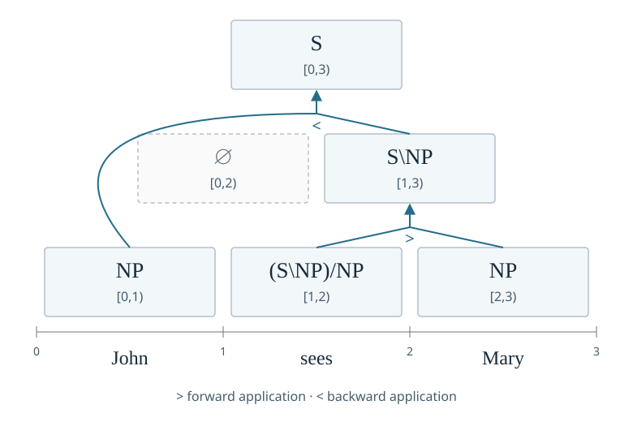

# Under the hood: charts and semirings

This chapter opens the chart that every parser in chapters 3 to 6 fills: it
indexes the spans of an input, builds the sweep that visits each [span](../explanation/charts-and-approximation.md#spans-and-the-sweep) after its
parts, and runs that one sweep under two semirings, first counting the binary
trees over the input and then scoring them in [log space](../explanation/charts-and-approximation.md#what-a-semiring-decides). It needs only the
base install, since nothing here touches PyTorch.

Three tokens already have two binary bracketings: `((a b) c)` and
`(a (b c))`. Longer inputs have many more. If we built every complete tree
separately, we would repeatedly solve the same problems for shorter spans.
A [chart](../explanation/charts-and-approximation.md#reusing-partial-analyses) stores a result for each span so that larger spans can reuse it.
Here we count all ordered binary bracketings, independently of any grammar's
categories or rules.

## Spans and their IDs

A [span](../explanation/charts-and-approximation.md#spans-and-the-sweep) is half-open: `(i, j)` covers the tokens from `i` up to but not including
`j`. For *the dog sleeps*, number the boundaries `0 the 1 dog 2 sleeps 3`:
`(0, 2)` covers *the dog*, and `(1, 3)` covers *dog sleeps*. [`SpanIndex`](../reference/deduce.md#lofi.deduce.SpanIndex)
computes spans for an input length and assigns their dense IDs, consecutive
integers that can be used to locate the spans in stored results.

This chart shows the [application analysis](../explanation/derivations-as-proofs.md#from-words-to-a-derivation) of *John sees Mary*:



The bottom cells contain one word each. The cell above *sees Mary* combines
`(S\NP)/NP` with `NP`, yielding `S\NP`. The top cell combines that result
with *John*'s `NP` to make `S`. The cell over *John sees* is empty: application
alone cannot combine its categories in that order. Arrows connect the two
input cells to their result. Each cell has one span, while its contents
describe the analyses found for that span.

The code below uses the span arrangement to count all binary bracketings,
including ones the grammar in this chart rejects.

```python
from lofi.deduce import SpanIndex

index = SpanIndex(5)

print(index.num_spans)
print(index.max_splits)
```

```text
15
4
```

A five-token input has fifteen spans of width one or more. Ids run in order of
increasing width and then increasing start, so the widest span, the one covering
the whole input, is the last:

```python
print(index.span_id(0, 5))
print(index.span_of(14))
```

```text
14
(0, 5)
```

A wider span always has a higher ID than its subspans. Sweeping in ID order
thus processes every antecedent, or input subspan, before the span that uses it.

A [split point](../reference/deduce.md#lofi.deduce.SpanIndex.splits) `k` divides `(i, j)` into `(i, k)` and `(k, j)`, both nonempty:

```python
print(list(index.splits(0, 3)))
```

```text
[1, 2]
```

## The sweep

[`binary_sweep`](../reference/deduce.md#lofi.deduce.SpanIndex.binary_sweep) yields each [span](../explanation/charts-and-approximation.md#spans-and-the-sweep) with each two-part decomposition in this order.
For one split, we combine a result for the left part with a result for the
right part. We then combine the alternatives from different splits. Those
are two different operations. When counting trees, two left trees and three
right trees give six combinations, so the first operation multiplies. Counts
from alternative splits add.

A [semiring](../explanation/charts-and-approximation.md#what-a-semiring-decides) supplies these two operations and their identity values,
subject to the [semiring laws](../how-to/extending/laws.md#check-a-semiring). [The interface](../reference/deduce.md#lofi.deduce.Semiring) calls
them `times`, `plus`, `one`, and `zero`. Each algebra defines the operations
and identity values with those roles. The following function uses them to
accumulate the sweep:

```python
def total(index, semiring):
    """Combine every binary tree over the input, in the given semiring."""
    chart = {}

    for i in range(index.n):
        chart[i, i + 1] = semiring.one

    for cell, left, right in index.binary_sweep():
        combined = semiring.times(chart[left], chart[right])
        chart[cell] = semiring.plus(chart.get(cell, semiring.zero), combined)

    return chart[0, index.n]
```

Every width-one span starts at `one`. Every wider span sums the product of its
two parts over its split points.

For counting, a single token has exactly one tree. An unfilled cell starts
at zero because no alternative has contributed yet. Each width-two span
has one split and thus $1\times1=1$ tree. For three tokens, the two
splits contribute $1\times1+1\times1=2$, recovering the two bracketings above.
The chart stores one count per span.

## Counting

Hand it [`Counting`](../reference/deduce.md#lofi.deduce.Counting), whose `plus` is addition and whose `times` is
multiplication over the nonnegative integers, and the accumulated value at the
root is the number of binary trees over the input:

```python
from lofi.deduce import Counting, SpanIndex

print(total(SpanIndex(5), Counting()))
print(total(SpanIndex(6), Counting()))
```

```text
14
42
```

These are the corresponding Catalan numbers.

## Scoring

With positive weights, a tree's weight multiplies the contributions of its
parts, and the total weight adds over alternative trees. Very small products
can be awkward to represent numerically. [Log space](../reference/deduce.md#lofi.deduce.LogInside) stores logarithms of
weights instead: $\log(ab)=\log(a)+\log(b)$, while adding weights becomes
$\log(a+b)=\operatorname{logsumexp}(\log a,\log b)$. Here
$\operatorname{logsumexp}(u,v)=\log(\exp(u)+\exp(v))$; implementations can
evaluate it without first forming very large or small exponentials.

Now hand the same function `LogInside`, whose `plus` is log-sum-exp and whose
`times` is addition:

```python
from lofi.deduce import LogInside, SpanIndex

print(round(total(SpanIndex(5), LogInside()), 6))
```

```text
2.639057
```

This is the logarithm of fourteen. With equal tree weights, the inside score is
the logarithm of the count. Changing lexical or rule weights changes the inside
score without changing the counting result.

In this algebra, `one` is the log weight $0=\log 1$, and `zero` is
$-\infty=\log 0$ in the extended-real convention. Adding `one` preserves a
log weight; taking log-sum-exp with `zero` preserves it as well. Converting the log total weight into
a log probability requires an appropriate [normalization](../explanation/charts-and-approximation.md#inside-outside-and-marginals). The resulting tree probabilities share the unit mass among the fourteen
equally weighted trees.

Recognition asks whether any analysis succeeds; counting asks how many;
inside scoring accumulates their weights. [Viterbi decoding](../reference/deduce.md#lofi.deduce.Viterbi), [k-best extraction](../reference/deduce.md#lofi.deduce.KBest),
and [expectation counting](../reference/deduce.md#lofi.deduce.Expectation) also use chart decompositions, with the corresponding
algebras and stored state. These computations use the traversal shown by `total` and add their own
algebras and stored state. The
[`parse.semiring`](../how-to/models/configure-a-chart-parser.md#choose-a-semiring) leaf of a [run document](../how-to/setup/configuration.md#the-words-this-site-uses), `log-inside` in every run of this
path, selects which algebra a run's chart is evaluated in.

## Try this

- Compare `total(SpanIndex(n), Counting())` with the Catalan number for a few
  more lengths, and note how quickly the count outgrows the lengths the
  tutorial corpora draw.
- In a copy of `total` used only for `LogInside`, replace the initial log
  weight at each width-one [span](../explanation/charts-and-approximation.md#spans-and-the-sweep) with a chosen log weight for that token.
  Compare its changed root score with the unchanged original [`Counting`](../reference/deduce.md#lofi.deduce.Counting) run.
  The same inventory of trees now contributes different weights to the total.

## Next

This chapter ends the path. The algebras that ship, and the protocol a new
one implements, are in the [deduce reference](../reference/deduce.md);
checking your own algebra against the semiring laws is
[Running the law suites](../how-to/extending/laws.md); and the decomposition
accessor is described in [The layer order](../explanation/layering.md).
